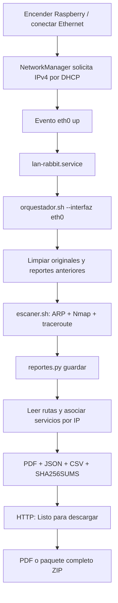

# Rabbyte · LAN Rabbit

**Conecta la Raspberry por Ethernet, espera el escaneo y descarga el reporte.**

Rabbyte reúne el descubrimiento de equipos, el escaneo de servicios y las rutas de traceroute en un informe PDF. Está pensado para trabajar sin pantalla: obtiene una IP por DHCP, ejecuta el proceso y publica los resultados en una página de descarga.

El repositorio contiene el código y las configuraciones del prototipo. Las contraseñas, las redes Wi-Fi y los resultados de los experimentos se mantienen fuera de Git.

## Qué hace

- Descubre IP y MAC con **arp-scan**.
- Revisa los puertos TCP de los equipos encontrados y consulta sus servicios y versiones con **Nmap**.
- Obtiene saltos con **Nmap traceroute**.
- Relaciona cada IP del diagrama con los puertos documentados.
- Genera un **PDF** con el árbol de rutas y tablas por equipo.
- Conserva los originales y produce JSON, CSV y hashes SHA-256.
- Ofrece el PDF y un ZIP mediante HTTP con autenticación.
- Reemplaza la ejecución anterior al comenzar una nueva.

El alcance es la red del laboratorio conectada a la interfaz elegida. Utiliza el dispositivo únicamente en redes donde tengas autorización para realizar estas pruebas.

## De encender a descargar



El servidor de descargas es independiente del escáner. Puede seguir atendiendo la página mientras el experimento está en curso. La página se actualiza cada cinco segundos y distingue **Esperando resultados**, **Proceso en curso** y **Listo para descargar**.

## Organización del repositorio

```text
rabbyte/
├── lan-rabbit/
│   ├── orquestador.sh           # Coordina el proceso
│   ├── reportes.py              # Interpreta y publica los resultados
│   ├── diagrama_reporte.py      # Convierte traceroute en rutas
│   ├── reporte_pdf.py           # Dibuja el árbol y las tablas del PDF
│   └── servidor_resultados.py   # Página y descargas autenticadas
├── rabbyte/
│   └── escaner.sh               # ARP, Nmap y traceroute
├── config/
│   ├── systemd/                # Escaneo automático y servidor HTTP
│   ├── NetworkManager/         # Eventos de Ethernet y ejemplo DHCP
│   └── sudoers.example         # Permisos para el arranque sin contraseña
├── scripts/
│   └── configurar_acceso.py    # Genera la autenticación local
├── docs/
│   └── RESULTADOS.md           # Formatos, archivos y alcance de los datos
└── tests/                      # Pruebas sin escanear ninguna red
```

### Carpetas en la Raspberry

El despliegue actual utiliza el usuario `pi` y estas rutas:

```text
/home/pi/
├── lan-rabbit/
│   ├── *.py
│   ├── orquestador.sh
│   ├── config/descargas_auth.json
│   ├── resultados/
│   ├── resultados.lock
│   ├── orquestador.lock
│   └── orquestador.log
└── rabbyte/
    ├── escaner.sh
    └── salidas originales del escáner
```

`lan-rabbit/` y `rabbyte/` son **carpetas hermanas**. El orquestador calcula sus rutas con esa estructura. El nombre del repositorio en GitHub no cambia las rutas del despliegue.

## Instalación en Raspberry Pi OS

Las instrucciones asumen el usuario `pi`, NetworkManager, `eth0` para Ethernet y systemd. Si usas otro usuario o ubicación, adapta las unidades de servicio y sus rutas antes de instalarlas.

### 1. Dependencias y código

```bash
sudo apt update
sudo apt install -y git python3 python3-reportlab nmap arp-scan network-manager util-linux sudo

git clone https://github.com/western1258/rabbyte.git ~/rabbyte-repo
cd ~/rabbyte-repo

mkdir -p ~/lan-rabbit/config ~/lan-rabbit/resultados ~/rabbyte
install -m 750 lan-rabbit/*.py lan-rabbit/orquestador.sh ~/lan-rabbit/
install -m 750 rabbyte/escaner.sh ~/rabbyte/escaner.sh
```

El repositorio es privado: para clonarlo necesitas acceso a GitHub. También puedes descargar su ZIP y ejecutar la copia de archivos desde la carpeta extraída. No clones encima de `~/rabbyte`, porque esa carpeta está destinada a las salidas del escáner.

### 2. Credenciales de descarga

```bash
python3 scripts/configurar_acceso.py --usuario juan
```

El comando solicita la contraseña sin mostrarla y crea `~/lan-rabbit/config/descargas_auth.json` con permisos restringidos. Guarda el usuario y el hash SHA-256 que espera el servidor; no escribe la contraseña en texto plano. No reemplaza una configuración existente.

### 3. DHCP por Ethernet

Consulta el perfil de Ethernet:

```bash
nmcli connection show
```

En la instalación original se llama `Wired connection 1`. Si tu perfil tiene otro nombre, sustitúyelo:

```bash
sudo nmcli connection modify "Wired connection 1" ipv4.method auto connection.autoconnect yes
```

Si todavía no existe un perfil, puedes crear uno:

```bash
sudo nmcli connection add type ethernet ifname eth0 con-name "LAN Rabbit Ethernet" ipv4.method auto connection.autoconnect yes
```

El archivo `config/NetworkManager/lan-rabbit-ethernet.nmconnection.example` muestra los campos básicos. No contiene UUID, contraseñas ni datos de una red concreta.

La red debe tener un servidor DHCP. Un switch sin DHCP no asigna una IP por sí solo. El proceso espera hasta 120 segundos una única IPv4 global en la interfaz.

### 4. Permisos del escáner

El orquestador se ejecuta como `pi`. Solo el escáner utiliza `sudo`, porque ARP y el escaneo SYN necesitan permisos elevados. Para funcionar sin pantalla no puede solicitar una contraseña.

Comprueba primero:

```bash
sudo -n true
```

Si tu instalación requiere configurar permisos, revisa `config/sudoers.example` y valídalo antes de instalarlo:

```bash
sudo visudo -cf config/sudoers.example
sudo install -o root -g root -m 440 config/sudoers.example /etc/sudoers.d/lan-rabbit
```

Ese ejemplo cubre Ethernet y el límite predeterminado de una hora. Si cambias la interfaz o el límite, debes ajustar también la regla. Quien tenga permiso para modificar el escáner puede modificar los comandos que ejecuta con privilegios: conserva el código bajo control de los administradores del dispositivo.

### 5. Servidor HTTP

```bash
mkdir -p ~/.config/systemd/user
install -m 644 config/systemd/lan-rabbit-resultados.service ~/.config/systemd/user/
systemctl --user daemon-reload
systemctl --user enable --now lan-rabbit-resultados.service
sudo loginctl enable-linger pi
```

El servidor escucha en el puerto **8080**. `linger` permite que el servicio de usuario funcione aunque no haya una sesión abierta.

### 6. Arranque automático

```bash
sudo install -o root -g root -m 644 config/systemd/lan-rabbit.service /etc/systemd/system/
sudo install -o root -g root -m 755 config/NetworkManager/90-lan-rabbit /etc/NetworkManager/dispatcher.d/
sudo systemctl daemon-reload
sudo systemctl enable lan-rabbit.service
```

En el siguiente encendido con cable, o al conectar Ethernet y recibir IP, se iniciará el experimento. Para iniciarlo inmediatamente con el cable ya conectado:

```bash
sudo systemctl start --no-block lan-rabbit.service
```

**Una ejecución nueva borra los originales y los reportes anteriores.** Descarga lo que necesites conservar antes de iniciarla.

## Uso diario

### Automático

1. Conecta Ethernet a la red de prueba y enciende la Raspberry.
2. DHCP asigna la IP y el servicio llama al orquestador con `--interfaz eth0`.
3. El escáner ejecuta ARP, Nmap y traceroute.
4. Se generan el PDF y el paquete descargable.
5. La página anuncia que los archivos están listos.

Si conectas el cable después de encender, el evento de NetworkManager inicia el mismo flujo. Al quitarlo se detiene el servicio; al reconectarlo comienza otra ejecución. Una renovación DHCP normal no vuelve a lanzar el escaneo.

### Manual

```bash
# Experimento completo por Ethernet
bash ~/lan-rabbit/orquestador.sh --interfaz eth0

# Solo volver a generar reportes desde los originales existentes
bash ~/lan-rabbit/orquestador.sh --solo-reportes

# Revisar rutas e interfaz sin limpiar ni escanear
bash ~/lan-rabbit/orquestador.sh --interfaz eth0 --comprobar

# Generador de reportes, sin pasar por el orquestador
python3 ~/lan-rabbit/reportes.py guardar
```

La interfaz manual predeterminada es `wlan0`; el servicio automático siempre indica `eth0`. Ejecuta el orquestador como `pi`, **sin `sudo` delante**.

Durante el uso normal no muestra mensajes de avance. Los errores aparecen en `~/lan-rabbit/orquestador.log` y, cuando se ejecuta como servicio, también en el journal.

### Límite de tiempo

El escáner tiene un límite de una hora. El proceso intentará producir un reporte con las salidas disponibles si el escáner termina con error o agota el tiempo.

```bash
TIEMPO_MAXIMO=7200 bash ~/lan-rabbit/orquestador.sh --interfaz eth0
```

Para el arranque automático, además de los permisos sudo, adapta `Environment=TIEMPO_MAXIMO=7200` y `TimeoutStartSec` en la unidad si necesitas ampliar el límite.

## Descargar los resultados

Consulta la dirección de la Raspberry:

```bash
ip -br -4 addr
```

Desde un equipo que pueda alcanzar esa IP, abre `http://IP_DE_LA_RASPBERRY:8080/` e inicia sesión con las credenciales de descarga.

| Estado de la página | Qué significa |
| --- | --- |
| Esperando resultados | Todavía no hay un paquete publicado válido. |
| Proceso en curso | El escáner o el generador tiene bloqueados los resultados. |
| Listo para descargar | El manifiesto está disponible y el PDF supera su comprobación de integridad. |

| Ruta | Contenido |
| --- | --- |
| `/` | Página de estado, actualizada cada cinco segundos. |
| `/reporte.pdf` | Informe con diagrama y servicios. |
| `/resultados.zip` | Originales, PDF, JSON, CSV y hashes. El ZIP se construye al descargarlo. |

El servidor HTTP está configurado para pruebas en una red de confianza (`--http-pruebas`). Utiliza autenticación Basic, que no cifra las credenciales por sí sola. El código admite TLS mediante `--tls-cert` y `--tls-key` si se configura HTTPS.

Después de extraer el ZIP, puedes verificarlo desde la carpeta `resultados`:

```bash
sha256sum -c SHA256SUMS
```

## Qué contiene el PDF

- **Diagrama de rutas:** árbol de los saltos observados y puertos asociados a cada IP.
- **Servicios por equipo:** MAC, fabricante disponible, puertos, estados, servicios, productos y versiones detectadas.

No incluye la sección de observaciones ni genera un reporte HTML alternativo. La página HTML solo sirve para consultar el estado y descargar archivos.

Los datos adicionales y los fallos de lectura quedan en `reporte.json` y `resumen.txt`. Consulta [formatos y resultados](docs/RESULTADOS.md) para conocer su estructura.

## Cómo se evita mezclar resultados

Los datos son **semipersistentes**: sobreviven al reinicio y permanecen hasta que empieza la siguiente ejecución completa. El orquestador retira las salidas anteriores del escáner y vacía `resultados/`, conservando código y configuración.

- `orquestador.lock` evita dos orquestadores al mismo tiempo.
- `resultados.lock` coordina la limpieza, la publicación y las descargas.
- `SHA256SUMS` se publica al final; sin él no se anuncia un paquete terminado.

Los archivos `.lock` pueden estar vacíos. No son datos del experimento y no deben borrarse mientras el sistema está funcionando.

## Diagnóstico rápido

```bash
# Escaneo automático
systemctl status lan-rabbit.service --no-pager
journalctl -u lan-rabbit.service -b --no-pager

# Página de descarga
systemctl --user status lan-rabbit-resultados.service --no-pager
ss -ltn | grep ':8080'

# Últimos errores y red
cat ~/lan-rabbit/orquestador.log
ip -br -4 addr
nmcli device status
```

| Problema | Revisar |
| --- | --- |
| No recibe IP | Cable, enlace de `eth0`, perfil con DHCP y servidor DHCP en la red. |
| El servicio queda `active (exited)` | Es normal después de terminar: la unidad es `oneshot` con `RemainAfterExit=yes`. |
| No vuelve a escanear | Reconecta Ethernet o usa `sudo systemctl restart --no-block lan-rabbit.service`. Esto comienza una ejecución nueva. |
| Solicita contraseña o falla sudo | Prueba `sudo -n true` y revisa la regla del comando del escáner. |
| El PDF no tiene diagrama | Comprueba que `~/rabbyte/tracerOW.txt` contiene bloques `TRACEROUTE` con saltos. |
| El resultado dice `parcial` | El escáner actual no entrega códigos individuales de ARP/Nmap; el generador no los inventa. |
| El navegador no llega a la página | Debe tener ruta a la IP de la Pi y al puerto 8080. El Wi-Fi y Ethernet pueden estar en redes distintas. |

## Alcance y limitaciones actuales

- ARP descubre equipos del segmento local. Nmap recibe las IP encontradas por ARP, no todas las direcciones posibles del segmento.
- El escáner hace diez pasadas ARP, revisa todos los puertos TCP de las IP detectadas y después consulta versiones en los puertos abiertos. Puede tardar según la cantidad de equipos y sus respuestas.
- Cada consulta de servicios agrega un documento a `nmap.xml`. El lector admite esa concatenación y conserva la última observación Nmap de cada IP.
- El escáner termina con `exit 0` sin exponer todos los fallos internos. El generador mantiene un estado conservador `parcial` cuando hay equipos; una descarga disponible no certifica que todas las herramientas hayan tenido éxito.
- Un árbol de traceroute representa rutas observadas, no el cableado físico. En una LAN es normal que muchos destinos aparezcan en el primer salto.
- No se inventan fabricante, versión o tipo de dispositivo cuando no están en los originales. El PDF no realiza un análisis de vulnerabilidades.
- El arranque se validó por configuración, sintaxis, eventos simulados y permisos sin sesión. La prueba física de encendido/reconexión en la red del experimento debe confirmar el recorrido completo.

## Validación del código

Las pruebas del repositorio no escanean ninguna red:

```bash
python3 -m unittest discover -s tests -v
python3 -m compileall -q lan-rabbit scripts tests
bash -n lan-rabbit/orquestador.sh
bash -n rabbyte/escaner.sh
sh -n config/NetworkManager/90-lan-rabbit
```

GitHub Actions ejecuta estas mismas comprobaciones. Para probar la integración real se necesita la Raspberry, permisos de escaneo y el laboratorio conectado.
